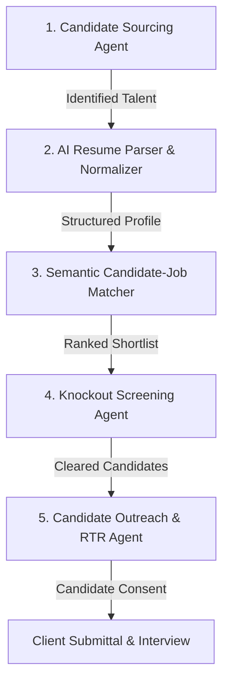

# Pavion RTS – Autonomous Recruitment & Sourcing AI Agents

This document defines the agent architecture, autonomous capabilities, and interaction protocol for AI agents operating within **Pavion RTS**.

---

## 🤖 Overview of Specialized Recruitment Agents

Pavion RTS deploys four specialized autonomous agents to orchestrate the end-to-end talent lifecycle:



---

## 1. Candidate Sourcing Agent (`agents/sourcing_agent.py`)
- **Role**: Talent Discovery & Boolean Search Strategist.
- **Mission**: Scans internal talent pools and external job board providers (LinkedIn, Dice, Indeed) to discover qualified candidates matching job requisitions.
- **Capabilities**:
  - Generates optimized Boolean search strings (`(AWS OR Cloud) AND (Java OR "Spring Boot") AND (Microservices)`).
  - Normalizes candidate skills against the 500+ entry Pavion IT Taxonomy (`config/skills_taxonomy.json`).
  - Checks candidate availability and passive vs. active job seeker status.

---

## 2. Autonomous Recruiter Agent (`agents/recruiter_agent.py`)
- **Role**: Holistic Candidate Evaluation & Requisition Ranking.
- **Mission**: Calculates multi-dimensional match scores across skill overlap, experience depth, domain keywords, and rate compatibility.
- **Scoring Rubric**:
  $$\text{Match Score} = (0.50 \times \text{Skills}) + (0.25 \times \text{Experience}) + (0.15 \times \text{Work Auth}) + (0.10 \times \text{Rate Alignment})$$

---

## 3. Screening & Knockout Agent (`agents/screening_agent.py`)
- **Role**: Compliance & Prerequisite Verification.
- **Mission**: Automatically evaluates answers against job-specific killer questions (e.g., USCIS work eligibility, required security clearance, relocation willingness, onsite vs. hybrid alignment).
- **Behavior**: Flagged disqualifications are instantly routed to recruiter review queue with clear reasoning.

---

## 4. Candidate Outreach & RTR Agent (`agents/outreach_agent.py`)
- **Role**: Recruiter Communication & Right-to-Represent (RTR) Lock.
- **Mission**: Generates personalized, professional outreach emails, collects candidate consent, locks exclusive Right-to-Represent agreements, and prepares client submittal dossiers.

---

## 🛠️ CLI & Agent Invocation

To execute agents locally or via background queues:

```bash
# Run Recruiter Candidate Ranking Agent
python3 agents/recruiter_agent.py --job-id REQ-2026-081 --min-score 75

# Run Sourcing Agent for Requisition
python3 agents/sourcing_agent.py --title "Cloud Data Engineer" --skills "Snowflake,Python,AWS"

# Run Batch Evaluation
python3 evals/matcher_evals.py
```
