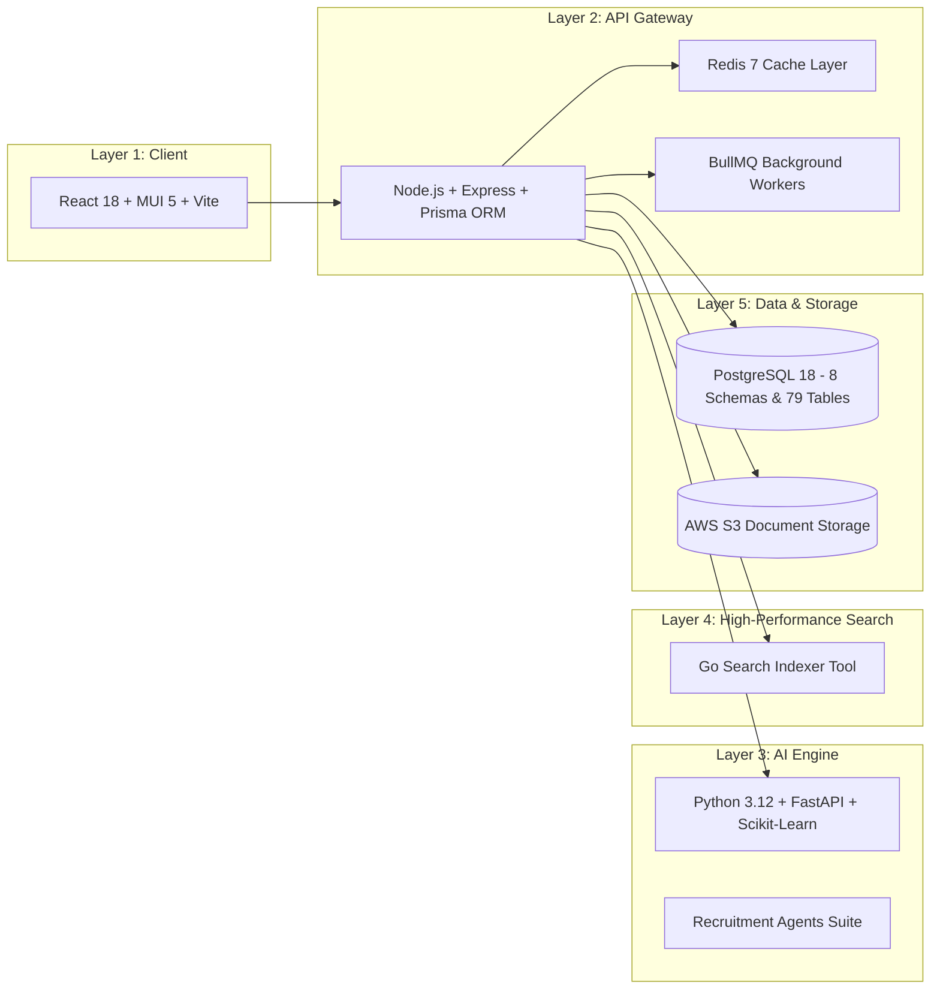

# Pavion RTS – Enterprise Polyglot Architecture & Data Dictionary

Comprehensive architectural reference for **Pavion RTS**, designed for high-throughput US Staffing agencies and Recruitment Process Outsourcing (RPO) firms.

---

## 🏛️ Polyglot Multi-Tier Architecture

Pavion RTS is organized into five decoupled architectural layers:

---

## 🗄️ Database Schemas (PostgreSQL 18)

| Schema | Tables | Description |
| :--- | :---: | :--- |
| **`core`** | 3 | Organizations, departments, system configuration |
| **`auth`** | 8 | Users, roles, granular permissions, session management |
| **`crm`** | 5 | Accounts (clients), contacts, leads, business opportunities |
| **`ats`** | 15 | Requisitions, candidate profiles, skills matrix, talent pools |
| **`recruitment`**| 22 | Central recruitment junction (`candidate_jobs`), stages, RTR, scorecards |
| **`compliance`** | 7 | Credential verifications, I-9/W-4, background checks, expiration tracking |
| **`operations`** | 10 | Tasks, activity timelines, notifications, communication logs |
| **`analytics`** | 9 | Audit logs, report snapshots, custom fields, data integrations |

---

## 🔐 Multi-Tenant & Compliance Isolation

- **Tenant Isolation**: Every database table contains `organization_id` with composite indexes and PostgreSQL Row-Level Security (RLS) policies.
- **RTR Compliance**: Strict candidate Right-to-Represent capture preventing dual-agency submittals.
- **Data Protection**: AES-256 encrypted storage on AWS S3 with signed temporary URLs.
