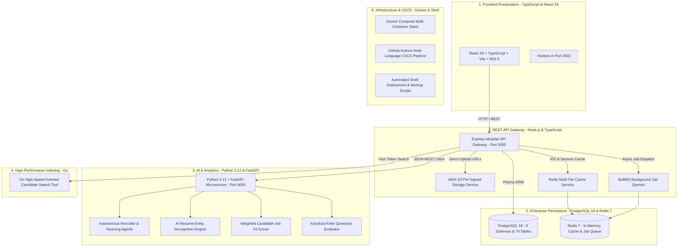

# Pavion Technologies – US Staffing ATS + CRM Enterprise Platform

[](https://paviontechnologies.com)
[](https://react.dev)
[](https://nodejs.org)
[](https://fastapi.tiangolo.com)
[](https://go.dev)
[-336791.svg)](https://postgresql.org)
[](https://redis.io)
[](https://docker.com)

An enterprise-grade, polyglot multi-tenant Applicant Tracking System (ATS) and Customer Relationship Management (CRM) platform engineered for high-volume US Staffing & Recruitment Agencies. Built on an enterprise multi-tier architecture matching industry leaders such as **Bullhorn, JobDiva, Salesforce, and Zoho**.

Developed and Maintained by **Pavion Technologies Pvt. Ltd.**

---

## 🏛️ Enterprise Polyglot Multi-Tier Architecture

Pavion RTS decouples UI presentation, transactional API gateway operations, asynchronous job queues, and CPU-intensive machine learning algorithms across dedicated architectural layers:



---

## 💻 Polyglot Technology Stack & Language Distribution

| Architectural Tier | Technology & Framework | Language | Primary Responsibilities |
| :--- | :--- | :--- | :--- |
| **Frontend Web App** | React 18, Vite, Material UI (MUI 5), TanStack Table | **TypeScript** | Responsive recruiter dashboards, candidate kanban, resume viewer, interview kits |
| **API Gateway** | Node.js 20, Express, Prisma ORM, Multer, Zod | **TypeScript** | REST routes, JWT multi-tenant auth, role-based access control, schema mapping |
| **AI Microservice & Agents**| Python 3.12, FastAPI, Uvicorn, Scikit-learn, Pydantic | **Python** | Automated resume parsing, skill taxonomy extraction, 4-tier candidate-job scoring |
| **Fast Search Indexer** | Go 1.22, Inverted Token Mapping, Goroutines | **Go** | Sub-millisecond candidate resume and skill keyword indexing and search |
| **Database & Analytics** | PostgreSQL 18 (8 Schemas, 79 Tables), GIN Indexes | **SQL** | Relational integrity, audit logs, RTR compliance, placement commissions, GIN search |
| **Cache & Queue** | Redis 7, BullMQ, In-Memory LRU Fallback | **TypeScript / C** | Dashboard KPI aggregates, session tokens, async submittal notifications |
| **Storage Layer** | AWS S3 SDK, Local Storage Driver | **TypeScript** | Secure pre-signed upload/download URLs, resume blobs, I-9/W-4 documents |
| **DevOps & CI/CD** | Docker Compose, Shell Automation, GitHub Actions | **Shell / YAML** | Multi-container builds, zero-downtime deployment, automated logical backups |

---

## 🚀 Key Modules & Capabilities

### 1. Dedicated Role-Based Dashboards
- 👑 **Super Admin Dashboard**: Multi-tenant isolation, organizational audit logs, global system health, and cross-office analytics.
- 🎯 **Recruiter Workbench**: 16-stage candidate funnel, resume upload dropzone, talent pools, candidate submittals, and interview scheduling.
- 💼 **Account Manager Portal**: Assigned accounts (TCS, Infosys, Wipro, Cognizant), active requisitions, candidate feedback tracking, and client rate negotiations.
- 📈 **Sales / BDE Suite**: Lead pipeline, deal forecasting, margin calculation, and account growth analytics.

### 2. Nine Specialized Enterprise ATS Modules
- 👥 **Talent Pools & Bench Management**: Segment active candidates into specialized pools (e.g., Cloud Architects, Java Leads, Data Engineers).
- 📋 **Automated Screening & Knockout Questions**: Configure job-specific killer questions with instant auto-disqualification.
- 📝 **Structured Interview Kits & Scorecards**: Standardized technical, behavioral, and culture-fit assessment rubrics.
- 📜 **Offers & Approval Workflows**: Two-tier approval chains, pay rate margin validation, and digital offer letter generation.
- 🤝 **Comprehensive Onboarding Workflows**: Pre-employment verification, background check tracking, I-9 / W-4 collection.
- ⚖️ **Compliance & Credential Tracking**: Expiration alerts (30/60 days) for OPT/CPT visas, H-1B filings, and professional certifications.
- 📬 **Omnichannel Communication Center**: Centralized email, SMS, and WhatsApp thread logging with submittal templates.
- 🔄 **Redeployment & Contractor Care**: Proactive alerts 30 days prior to contract termination for fast redeployment.
- 🏢 **Vendor Management (VMS) & Subcontractors**: Tier-1 vendor scorecards, C2C master service agreements, and sub-tier compliance.

---

## 📁 Repository Directory Structure

```text
.
├── .agents/                    # Autonomous AI Recruiter & Sourcer Agent Specs
├── agents/                     # Python & TypeScript AI Recruitment Agents
│   ├── recruiter_agent.py      # Autonomous candidate matching and ranking agent
│   ├── sourcing_agent.py       # Candidate talent pool discovery agent
│   ├── screening_agent.py      # Knockout killer question evaluation agent
│   └── outreach_agent.py       # Candidate submittal & RTR negotiation agent
│
├── templates/                  # ATS Artifact Templates
│   ├── resumes/                # Clean ATS-compliant resume templates (HTML, CSS, JSON, LaTeX)
│   ├── cover-letters/          # Targeted cover letter templates
│   ├── emails/                 # US Staffing outreach, RTR consent, interview invite, offer letters
│   └── scorecards/             # Structured technical and behavioral scorecard rubrics
│
├── jds/                        # Curated US Staffing Job Descriptions (20+ Tech & Non-Tech Roles)
│   ├── cloud/                  # AWS Solutions Architect, Azure Cloud Engineer, GCP DevOps
│   ├── fullstack/              # Java Spring Boot Lead, Python FastAPI Dev, React Architect
│   ├── data/                   # Snowflake Data Engineer, Databricks Spark Specialist
│   ├── crm-erp/                # Salesforce Apex Developer, SAP S/4HANA Consultant
│   └── cybersecurity/          # IAM & SecOps Engineer, SDET QA Automation
│
├── interview-prep/             # Comprehensive Interview Kits & Question Banks
│   ├── technical/              # System design, DSA, coding questionnaires by role
│   ├── behavioral/             # STAR-method behavioral rubrics & culture-fit questions
│   └── knockout/               # Visa sponsorship, location, rate knockout killer questions
│
├── evals/                      # AI Benchmark & Evaluation Suite
│   ├── resume_evals.py         # Parsing accuracy & entity recognition benchmark
│   ├── matcher_evals.py        # Semantic candidate-job scoring evaluation
│   └── test_cases/             # Golden test fixtures & evaluation benchmarks
│
├── providers/                  # Job Board & Talent Source Integrations
│   ├── linkedin.provider.ts    # LinkedIn Talent Solutions integration stub
│   ├── dice.provider.ts        # Dice Tech Sourcing API connector
│   └── indeed.provider.ts      # Indeed sponsored jobs client
│
├── plugins/                    # Browser Extension & IDE Plugins
│   └── chrome-sourcing-plugin/ # Chrome Manifest V3 1-click candidate sourcing extension
│
├── batch/                      # High-Throughput Batch Processing Workers
│   ├── bulk_resume_parser.py   # Parallel multi-core resume ingestion pipeline
│   ├── nightly_compliance.py   # Scheduled 30/60-day visa and credential auditor
│   └── candidate_rediscovery.py# Rediscover archived candidates for new requisitions
│
├── config/                     # Enterprise Staffing Governance & Taxonomy
│   ├── skills_taxonomy.json    # 500+ classified US IT staffing skills
│   ├── compliance_rules.json   # USCIS OPT/CPT/H-1B, E-Verify, and I-9 rules
│   └── rate_cards.json         # Tier-1 vendor bill & pay rate limits by region
│
├── tools/indexer/              # High-Performance Search Indexer in Go
│   ├── main.go                 # Fast inverted indexer for candidate resumes
│   └── go.mod                  # Go module definition
│
├── reports/                    # Recruiter KPI & Client Profitability Engine
│   ├── gross_margin.py         # Spread and commission calculation engine
│   └── submittal_generator.py  # Formats professional client submittal packets
│
├── seeds/                      # Comprehensive US Staffing Seed Data
│   ├── candidates_master.json  # 100+ realistic candidate records with full histories
│   └── requisitions_master.json# 30+ active enterprise client requisitions
│
├── client/                     # Frontend Application (React 18 + TypeScript + Vite + MUI)
├── server/                     # Backend API Gateway (Node.js + Express + Prisma ORM)
├── services/ai-engine/         # Python AI Microservice (Python 3.12 + FastAPI)
├── database/                   # Production Database Architecture & SQL Scripts
├── scripts/                    # DevOps & Infrastructure Shell Automation
├── .github/workflows/          # CI/CD Automation
└── docs/                       # Training Portal, User Manuals & Interactive Demos
```

---

## 🛠️ Quick Start & Local Execution

### Option A: Automated Bootstrap Script (Recommended)
```bash
./scripts/setup_dev.sh
```

### Option B: Step-by-Step Manual Launch

#### 1. Start Database & In-Memory Cache
Ensure PostgreSQL is active on port `5432` and Redis is active on port `6379`.

#### 2. Launch Python AI Microservice (Port 8000)
```bash
cd services/ai-engine
python3 -m pip install -r requirements.txt
python3 -m unittest test_ai_engine.py
uvicorn main:app --host 0.0.0.0 --port 8000 --reload
```
- Endpoint Healthcheck: `http://localhost:8000/health`
- Interactive OpenAPI Docs: `http://localhost:8000/docs`

#### 3. Test High-Speed Go Search Indexer
```bash
cd tools/indexer
go test -v ./...
go run main.go
```

#### 4. Launch Backend REST Gateway (Port 5055)
```bash
cd server
npm install
npm run build
npm run dev
```
- REST API Base: `http://localhost:5055/api/v1`
- Interactive Swagger UI: `http://localhost:5055/api-docs`
- Prisma Studio: `npx prisma studio --port 5555`

#### 5. Launch Frontend Web App (Port 3003)
```bash
cd client
npm install
npm run dev
```
- Access Platform UI: `http://localhost:3003`

---

## 🌐 Enterprise Port Directory

| Service | Port / URL | Description |
| :--- | :--- | :--- |
| **Frontend Web App** | [`http://localhost:3003`](http://localhost:3003) | React 18 + Vite + MUI ATS/CRM Web Platform |
| **Backend REST API** | [`http://localhost:5055`](http://localhost:5055) | Express + Prisma REST API Gateway |
| **Swagger API Docs** | [`http://localhost:5055/api-docs`](http://localhost:5055/api-docs) | Interactive OpenAPI 3.0 API Documentation |
| **Python AI Engine** | [`http://localhost:8000`](http://localhost:8000) | FastAPI AI Resume Parser & Semantic Matcher |
| **AI Swagger Docs** | [`http://localhost:8000/docs`](http://localhost:8000/docs) | Interactive FastAPI Documentation |
| **Database Studio** | [`http://localhost:5555`](http://localhost:5555) | Prisma Studio (All Tables & Live Records) |
| **Documentation Portal** | [`http://localhost:8080`](http://localhost:8080) | Standalone Training Portal & User Manuals |

---

## 📄 License & Proprietary Rights
Copyright © 2026 Pavion Technologies Pvt. Ltd. All Rights Reserved.  
Confidential and Proprietary. Unauthorized copying, reverse engineering, or distribution is strictly prohibited.
