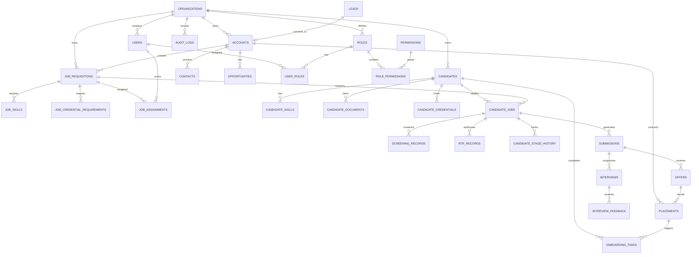
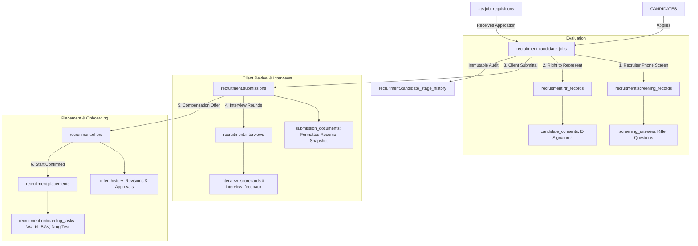

# Pavion Technologies: Complete Entity Relationship Architecture

This document contains the complete **Entity-Relationship Diagram (ERD)** for the Pavion Technologies US Staffing ATS + CRM platform, strictly reflecting the enterprise relational structure specified in the architecture blueprint.

---

## 1. Enterprise System ERD (Complete Relationship Architecture)



---

## 2. Central Recruitment Engine (`CANDIDATE_JOBS`) Data Flow



---

## 3. Entity Multi-Tenancy & Referential Integrity

All tables across the 8 domain schemas implement composite keys referencing the tenant organization:

```sql
-- Multi-Tenant Composite Foreign Key Enforcement
ALTER TABLE ats.candidates 
    ADD CONSTRAINT uq_candidate_org UNIQUE (organization_id, id);

ALTER TABLE ats.job_requisitions 
    ADD CONSTRAINT uq_job_org UNIQUE (organization_id, id);

ALTER TABLE recruitment.candidate_jobs 
    ADD CONSTRAINT fk_candidate_jobs_candidate 
    FOREIGN KEY (organization_id, candidate_id) 
    REFERENCES ats.candidates (organization_id, id) ON DELETE CASCADE;

ALTER TABLE recruitment.candidate_jobs 
    ADD CONSTRAINT fk_candidate_jobs_job 
    FOREIGN KEY (organization_id, job_id) 
    REFERENCES ats.job_requisitions (organization_id, id) ON DELETE CASCADE;
```
